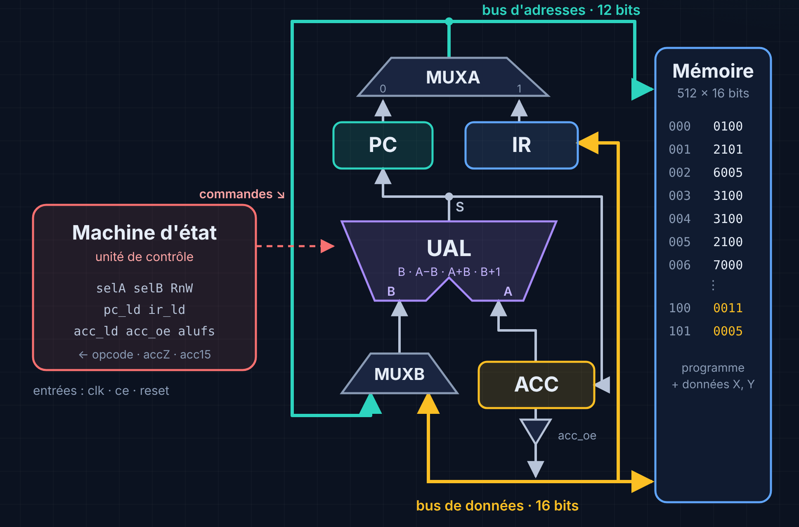
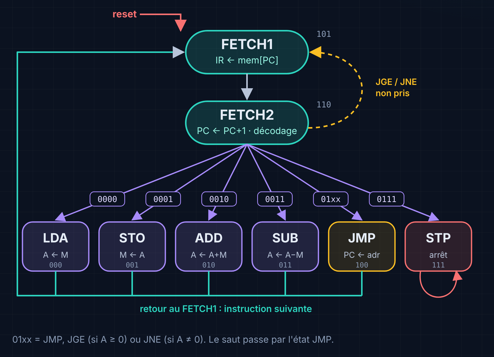
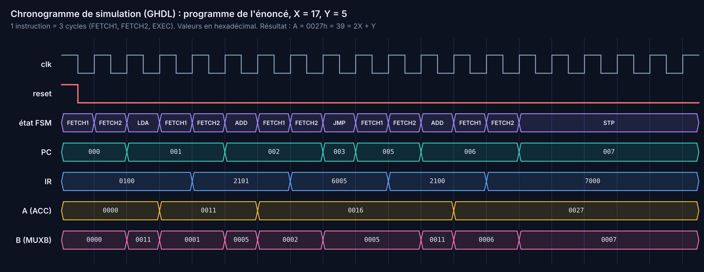

# Mini-processeur 16 bits en VHDL, sur FPGA Spartan-6


Conception complète d'un processeur 16 bits à accumulateur, décrit en VHDL,
vérifié par simulation puis implanté sur une carte FPGA Xilinx Spartan-6.
L'exécution s'observe en temps réel sur un écran LCD 16×2 ou sur des
afficheurs 7 segments : compteur programme (PC), accumulateur (A), entrée B de
l'UAL et état de la machine d'état.

> *English:* a 16-bit accumulator-based CPU written in VHDL (datapath + hard-wired
> FSM), verified with self-checking testbenches and running on a Spartan-6 FPGA
> with live display of PC, ACC and ALU input on a 16×2 LCD or 7-segment displays.

<p align="center">
  
</p>

## Sommaire

- [Caractéristiques](#caractéristiques)
- [Architecture](#architecture)
- [Jeu d'instructions](#jeu-dinstructions)
- [Machine d'état](#machine-détat)
- [Horloge : clock enable](#horloge--clock-enable)
- [Structure du dépôt](#structure-du-dépôt)
- [Simulation](#simulation)
- [Implantation sur la carte](#implantation-sur-la-carte)
- [Résultats](#résultats)
- [Documentation](#documentation)

## Caractéristiques

| | |
|---|---|
| Bus de données | 16 bits |
| Bus d'adresses | 12 bits (mémoire implantée : 512 mots) |
| Instructions | 8 (`LDA`, `STO`, `ADD`, `SUB`, `JMP`, `JGE`, `JNE`, `STP`) |
| Contrôle | machine d'état câblée à 8 états, écrite en équations logiques |
| Cycles par instruction | 3 (FETCH1, FETCH2, exécution) |
| Horloge | une seule horloge (50 ou 100 MHz) + *clock enable* à 1 Hz ou pas à pas |
| Affichage | LCD 16×2 HD44780 (mode 8 bits) ou 4 afficheurs 7 segments multiplexés |
| Vérification | 3 testbenches auto-vérifiants + intégration continue GitHub Actions |

## Architecture

| Bloc | Rôle |
|---|---|
| **PC** | adresse de la prochaine instruction |
| **IR** | instruction en cours (opcode 4 bits + adresse 12 bits) |
| **ACC** | accumulateur, opérande implicite. Fournit `accZ` (= 0) et `acc15` (signe) |
| **UAL** | `S = B`, `A − B`, `A + B`, `B + 1` selon `alufs` |
| **MUXA** | choisit l'adresse : PC (lecture d'instruction) ou IR (opérande) |
| **MUXB** | choisit l'entrée B de l'UAL : l'adresse (PC+1, saut) ou la donnée lue |
| **Porte 3 états** | met l'ACC sur le bus de données pendant `STO` |
| **Machine d'état** | génère `selA`, `selB`, `RnW`, `pc_ld`, `ir_ld`, `acc_ld`, `acc_oe`, `alufs` |

## Jeu d'instructions

Format : `[15:12] opcode | [11:0] adresse`

| Instruction | Opcode | Action |
|---|---|---|
| `LDA adr` | `0000` | ACC ← mem[adr] |
| `STO adr` | `0001` | mem[adr] ← ACC |
| `ADD adr` | `0010` | ACC ← ACC + mem[adr] |
| `SUB adr` | `0011` | ACC ← ACC − mem[adr] |
| `JMP adr` | `0100` | PC ← adr |
| `JGE adr` | `0101` | si ACC ≥ 0 : PC ← adr |
| `JNE adr` | `0110` | si ACC ≠ 0 : PC ← adr |
| `STP` | `0111` | arrêt |

Programme de démonstration chargé en mémoire :

```text
000  LDA @100h     ; A = X
001  ADD @101h     ; A = X + Y
002  JNE 005h      ; si A /= 0 aller en 005
003  SUB @100h
004  SUB @100h
005  ADD @100h
006  STP
100h : X = 17      101h : Y = 5
```

Résultat : `2X + Y` si `X + Y ≠ 0`, sinon `Y`. Avec X = 17 et Y = 5, on obtient **A = 39 (0027h)**.

## Machine d'état

<p align="center">
  
</p>

Les 8 états sont codés sur 3 bascules D (`q2 q1 q0`). L'état suivant et les
commandes sont décrits par des équations logiques (VHDL flot de données), par exemple :

```vhdl
d1     <= (q2 and q0) or (q2 and q1 and n1);
pc_ld  <= q2 and (not q0);
acc_ld <= ((not q2) and (not q0)) or ((not q2) and q1);
```

## Horloge : clock enable

La carte fournit 50 MHz (100 MHz sur la Nexys 3), beaucoup trop vite pour
suivre l'exécution à l'œil. Plutôt que de fabriquer une horloge lente avec un
compteur, ce qui est fragile sur FPGA, **tous les registres restent sur
l'horloge de la carte** et n'avancent que lorsque `ce = '1'` :

```vhdl
if rising_edge(clk) then
    if reset = '1' then
        reg_acc <= (others => '0');
    elsif ce = '1' and acc_ld = '1' then
        reg_acc <= acc_in;
    end if;
end if;
```

`ce` est une impulsion d'un cycle produite toutes les `N = f_clk × T` périodes
(1 Hz par défaut), ou à chaque appui sur un bouton en mode pas à pas, avec anti-rebond.
L'affichage, lui, tourne à pleine vitesse et suit les registres en direct.

## Structure du dépôt

```text
mini-processeur-vhdl/
├── src/
│   ├── cpu_mini_processeur.vhd   # MUX, IR, FSM, PC, ACC, UAL, mémoire, uProcesseur, gup
│   ├── utilitaires.vhd           # générateur de tick, synchronisation, anti-rebond
│   ├── affichage_7seg.vhd        # décodeur + balayage 4 digits
│   ├── lcd_hd44780.vhd           # contrôleur LCD 16x2 (8 bits)
│   ├── top_7seg.vhd              # top : processeur + 7 segments + LEDs
│   └── top_lcd.vhd               # top : processeur + LCD + LEDs
├── sim/
│   ├── tb_gup.vhd                # processeur seul, 2 branches de JNE
│   ├── tb_top_7seg.vhd           # relit les afficheurs, teste le pas à pas
│   └── tb_top_lcd.vhd            # modèle de LCD, reconstitue l'écran
├── constraints/
│   ├── top_7seg_nexys3.ucf       # broches Digilent Nexys 3
│   └── top_lcd_modele.ucf        # modèle à compléter selon la carte
├── docs/
│   ├── mini_processeur_vhdl.pdf  # présentation illustrée du projet
│   └── images/
├── scripts/
│   ├── run_sim.sh                # lance toutes les simulations (GHDL)
│   └── plot_wave.py              # trace le chronogramme depuis le VCD
└── .github/workflows/simulation.yml
```

## Simulation

Avec [GHDL](https://github.com/ghdl/ghdl) :

```bash
bash scripts/run_sim.sh          # analyse + 3 testbenches (échec si une assertion échoue)
bash scripts/run_sim.sh --wave   # + régénère docs/images/chronogramme.png
```

Avec ModelSim : compiler `src/*.vhd` puis `sim/*.vhd` (VHDL-93), et lancer `tb_gup`,
`tb_top_7seg` ou `tb_top_lcd`.

Les mêmes testbenches tournent automatiquement sur GitHub Actions à chaque *push*.

## Implantation sur la carte

1. Créer un projet Xilinx ISE pour le bon composant (ex. `XC6SLX16-CSG324-3` pour la Nexys 3).
2. Ajouter les fichiers de `src/`. Mettre ceux de `sim/` en **Simulation only**.
3. Choisir le top : `top_lcd` (écran LCD 16×2) ou `top_7seg` (afficheurs), puis *Set as Top Module*.
4. Ajouter l'UCF correspondant de `constraints/`.
5. Ajuster les *generics* du top :

| Generic | Défaut | Rôle |
|---|---|---|
| `CLK_FREQ` | `50000000` | fréquence de l'horloge de la carte (Hz) |
| `PERIODE_CPU_MS` | `1000` | durée d'un cycle processeur en mode automatique |
| `RESET_ACTIF_BAS` / `BTN_ACTIF_BAS` | `false` | polarité des boutons |
| `SEG_ACTIF_BAS` / `AN_ACTIF_BAS` | `true` | polarité des segments et des digits |
| `X_INIT` / `Y_INIT` | `17` / `5` | données du programme (adresses 100h et 101h) |

6. *Generate Programming File*, puis programmer la carte avec iMPACT ou Adept.

Commandes sur la carte : `sw_mode` (0 = automatique, 1 = pas à pas), `btn_pas`,
`btn_reset`. En version 7 segments, `sw_sel` choisit A, B, PC ou IR.

## Résultats



Écran LCD en fin d'exécution :

```text
PC=007  STP
A=0027  B=0007
```

## Documentation

- [`docs/mini_processeur_vhdl.pdf`](docs/mini_processeur_vhdl.pdf) : présentation illustrée
  (FPGA, niveaux d'abstraction, architecture, machine d'état, horloge, flot de conception).

## Auteur

**Nourhen Bahrouni**. Projet réalisé dans le cadre d'un cours d'électronique numérique.

Licence [MIT](LICENSE).
